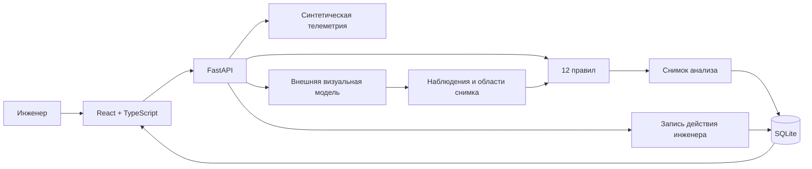

# Архитектура КОНТУР

## Поток осмотра

React показывает паспорт агрегата, графики, карту узлов, предупреждения и историю. FastAPI получает выбранный демосценарий, объединяет визуальные наблюдения и выполняет правила. SQLite хранит результаты и действия. Модель получает снимок через серверный адаптер, ключ не передаётся браузеру.

Vite обслуживает интерфейс в разработке и проксирует `/api` на порт 8000. После `npm run build` FastAPI может отдавать `apps/web/dist` с того же адреса, что и API.

## Границы модулей

| Путь | Назначение |
|---|---|
| `apps/web/src/App.tsx` | Рабочая область, сценарии, карточки узлов и регистрация результатов |
| `apps/web/src/features/CameraPanel.tsx` | Живой осмотр с рамками поверх видео, QR и встроенный AR |
| `apps/web/src/features/StandPanel.tsx` | QR-код и печатный стенд |
| `apps/web/public/ar.html` | Маркерный AR на A-Frame и AR.js |
| `services/api/app/main.py` | HTTP-контракты, объединение входов, фиксация результата |
| `services/api/app/diagnostics/engine.py` | Вычисление признаков, 12 правил, пропуски и объединение гипотез |
| `services/api/app/demo.py` | Детерминированные сценарии телеметрии и наблюдений |
| `services/api/app/equipment.py` | Единственный демонстрационный паспорт Н-101 |
| `services/api/app/live.py` | Сессии живой камеры: приём кадров по одному, место подключения детектора |
| `services/api/app/vision.py` | Вызов модели и строгая проверка её ответа |
| `services/api/app/storage.py` | Добавление снимков анализа и событий в SQLite |

## HTTP-контракт

| Метод и путь | Результат |
|---|---|
| `GET /api/health` | Доступность процесса API |
| `GET /api/bootstrap` | Паспорт, перечень сценариев, конфигурация визуального адаптера |
| `GET /api/equipment` | Паспорт с информацией о записях и заменах |
| `POST /api/analyze` | Сохранённый снимок анализа выбранного сценария и наблюдений |
| `POST /api/vision` | Сохранённый структурированный результат анализа снимка |
| `POST /api/live/sessions` | Новая сессия живой камеры для объекта: идентификатор, размер кадра, состояние детектора |
| `POST /api/live/sessions/{id}/frames/{n}` | Рамки по одному кадру JPEG (тело запроса — сам кадр) или статус `busy` / `stale` |
| `POST /api/live/findings` | Признак, подтверждённый инженером: новый осмотр с кадром и пересчитанными правилами, запись «Замечание» в журнале на узел признака |
| `GET /api/inspections` | Все события вместе с исходным анализом |
| `POST /api/inspections` | Новая проверка, замечание, обслуживание или замена |
| `GET /api/images/{image_id}` | Сохранённый снимок осмотра с соответствующим MIME-типом |

Точные схемы запросов доступны в `/docs`. `AnalyzeRequest` принимает `scenario_id`, необязательные `vision_id` и `image`, а также ручные наблюдения `{kind, present, timestamp?}`. `image` — data URL допустимого изображения. Он позволяет сохранить снимок и при ручном осмотре без ответа модели. При подключении результата модели демонстрационные наблюдения её трёх классов заменяются результатом модели. Ручное наблюдение заменяет прежнее наблюдение того же класса. Источник сохраняется как `demo`, `model` или `manual`.

Запись работы ссылается на уже существующий анализ через `analysis_id`. Она включает `component_id`, `action`, `notes`, `author`. Неизвестный узел, неизвестный анализ или попытка зарегистрировать работу непосредственно по записи визуального ответа отклоняются.

## Объяснимые результаты

Правило возвращает одно из состояний: `triggered` (условия выполнены), `clear` (условия не выполнены), `insufficient` (выводу не хватает данных). Неполные, устаревшие или несогласованные входы не подменяются нормальными значениями. Одна точка не доказывает тренд.

Предупреждение содержит гипотезу, узел, приоритет, идентификаторы правил, измерения, использованные пороги, источники и следующий шаг проверки. Совпадающие гипотезы кавитации R02/R12 объединяются с сохранением оснований. Визуальное отсутствие кожуха проверяется отдельно от состояния датчиков.

КПД, перекос фаз и расхождение давления имеют явные формулы. Падение КПД на 15% означает относительное изменение, а не 15 процентных пунктов. Показания давления сравниваются по времени, единицам и заданному знаменателю. Упоминание интервалов обслуживания или ресурса относится только к демонстрационным параметрам.

## Модель и недоступность сервиса

`VisionClient` обращается к локальной модели Qwen3-VL 4B, запущенной через llama.cpp: `LOCAL_VISION_URL` (по умолчанию `http://127.0.0.1:8081/v1`) и `LOCAL_VISION_MODEL` (по умолчанию `Qwen3-VL-4B-Instruct`). Клиент принимает только адрес loopback без учётных данных, поэтому снимок не может уйти за пределы сервера; облачного запасного вызова нет. Доступность проверяется запросом `/health` с тайм-аутом 3 секунды, анализ снимка — `POST /v1/chat/completions` с тайм-аутом 180 секунд.

Ответ ограничен семью насосными наблюдениями (отсутствие кожуха, жидкость у уплотнения, отсутствующий болт, коррозия рамы, низкий уровень и изменение вида масла, повреждение контакта) и описательными признаками других типов. Качество `good` передаётся в правила вместе с наблюдениями. `limited` не считается достаточным модельным основанием для срабатывания, а `unreadable` даёт пустой список наблюдений. Адаптер не создаёт числовой `confidence`. `bbox` задаётся четырьмя нормированными координатами `[x1,y1,x2,y2]` в диапазоне 0–1. Неизвестные поля, некорректные координаты и нарушенная структура отклоняются.

Ошибка сети, тайм-аут, HTTP-ошибка или некорректный ответ возвращаются пользователю явно. Демонстрационный режим не подменяет неудачный ответ модели. Зафиксирован один анализ за 4,83 с; точность распознавания не измерялась.

Интерфейс осмотра больше не вызывает `POST /api/vision`: загрузку снимка и анализ по кнопке заказчик запретил. Адаптер Qwen остаётся на сервере для пояснений к отдельному кадру и чтения таблички. Снимок передаётся модели только по явному запросу. В локальном результате сохраняются наблюдения, модель, источник, время и `image_id`. Переданное на сервер изображение хранится в таблице `images` как data URL. SHA-256 от data URL служит идентификатором, `INSERT OR IGNORE` исключает повторное хранение одинаковых данных. Браузер может уменьшать и перекодировать загруженный файл до отправки, поэтому база хранит именно снимок осмотра, полученный сервером.

## История и обслуживание

Таблица `analyses` хранит JSON-снимок результата и ссылку `image_id`, если изображение приложено. Таблица `events` ссылается на анализ внешним ключом. Таблица `images` хранит изображения отдельно. История показывает снимок через `/api/images/{image_id}`. В интерфейсе и API нет редактирования/удаления событий. Последующее переключение демосценария не переписывает основания ранее сохранённой работы.

Обслуживание всего агрегата учитывается при следующем расчёте интервала обслуживания. Для заменённого компонента карточка считает наработку от значения, сохранённого в анализе на момент замены, и пересчитывает нормативный остаток. Другие узлы сохраняют свои опорные значения. Неизвестная текущая или опорная наработка не заменяется нулём и даёт неизвестный результат. Это нормативный расчёт, а не оценка времени до отказа. Регламентный срок, время до ТО и признаки фактического состояния остаются разными понятиями.

Хранилище локальное, без разграничения ролей, криптографической защиты журнала и резервного копирования как сервиса. Автор записи по умолчанию — «Демо-инженер». Эти свойства подходят для демонстрации, но требуют доработки перед многопользовательской эксплуатацией.

## QR и AR

QR с содержимым `kontur:<equipment_id>` идентифицирует карточку объекта каталога; идентификатор проверяется по `GET /api/catalog`, незнакомый код карточку не открывает. Маркер Hiro задаёт положение печатного стенда. Координаты AR-узлов заранее заданы относительно схемы, поэтому масштаб и взаимное расположение схемы/маркера на стенде нужно сохранять.

Локальные зависимости находятся в `public/vendor`. Для всех 10 компонентов карточки заданы AR-метки. При потере маркера объекты скрываются. Нажатие метки показывает название узла, подробные основания доступны в карточке рабочего интерфейса. AR не определяет геометрию произвольного оборудования. Области модели привязаны только к неподвижному снимку и не отслеживаются в видеопотоке.

Обнаружение Hiro и скрытие меток после его потери проверены в браузере на поданном видеопотоке печатного стенда: `markerDetected=true`, `markerHiddenAfterLoss=true`, `errors=[]`. Этот прогон не использует физический телефон.

Для камеры необходим HTTPS либо localhost на том же устройстве. Доверенный адрес для реального телефона и испытания на нём остаются отдельным этапом. Проверка видеопотока и мобильной вёрстки не заменяет проверку физической камеры в условиях площадки.

## Живой осмотр

Телефон открывает сессию (`POST /api/live/sessions`) и отправляет кадры JPEG по одному: следующий кадр уходит только после ответа на предыдущий, поэтому на медленной сети очередь не растёт. Длинная сторона кадра уменьшается до значения `max_side` из ответа сервера (640 px). Сервер анализирует один кадр за раз для всех сессий: пока кадр в работе, другой получает ответ `busy` сразу, без ожидания. Кадр старше уже обработанного получает `stale`. Рамки приходят в нормированных координатах `[x1,y1,x2,y2]`, сервер обрезает их по границам кадра и отбрасывает рамки нулевой площади и уверенность вне 0–1.

Кадры обрабатываются в памяти и не сохраняются; сохраняется только кадр, который инженер явно подтвердил как свидетельство. `app/live_findings.py` переводит класс детектора в ручное наблюдение демо-правил и в класс дефекта реестра и выбирает узел для записи. Признак, которому на этом оборудовании нет места (например, подтёк масла у центробежного демо-агрегата), записать нельзя: сервер отвечает 422 и объясняет почему. Над видео показывается подсказка «Куда навести камеру»: узлы из сработавших правил, самые серьёзные первыми. Детектор выбирается переменной `KONTUR_DETECTOR` (`owlvit` или `owlv2`, см. `services/api/app/detector.py`) или передаётся в `create_app(detector=...)`. Без библиотек, без весов на диске или без выбора работает заглушка `NullDetector`: она ничего не находит и называет причину. Интерфейс показывает это явно, а не как «проблем не найдено». Сервер читает веса только из `.models/detectors/` и сам ничего не скачивает.

Признак подтверждается, если встречается на 3 из 5 последних обработанных кадров. Каждый ответ несёт оценку из ТЗ §4.2: `no_visible_issues` («видимых проблем не обнаружено», только после пяти чистых кадров подряд), `check_recommended` («рекомендуется проверка»: признак есть, но не подтверждён), `possible_defect` («обнаружены признаки возможного дефекта»), а также `unavailable` и `warming_up`, когда вывод делать рано.

Детектор без обучения ищет признаки по текстовым запросам (OWL-ViT и OWLv2, Apache 2.0). Отсутствие кожуха он увидеть не может, поэтому запрос — видимая муфта: если муфта открыта, кожуха на месте нет. Муфта вне кадра ничего не доказывает.

Замер 14.11.2026 на MacBook Air (Apple Silicon), сервер и браузер на одной машине, заглушка вместо детектора: около 7 кадров в секунду при ответе сервера 6–7 мс; пауза между кадрами — 120 мс. Это скорость доставки кадров, а не распознавания.

Скорость детектора, тот же компьютер, кадр 640 px JPEG как с телефона, без сети (`scripts/qa/bench-detector.py`, 30 замеров на трёх демо-изображениях после прогрева):

| Модель | Устройство | Медиана | 90-й процентиль | Кадров в секунду |
|---|---|---|---|---|
| OWL-ViT base/32 | графический процессор (MPS) | 95 мс | 101 мс | ≈10 |
| OWL-ViT base/32 | процессор | 168 мс | 175 мс | ≈6 |
| OWLv2 base/16 | графический процессор (MPS) | 684 мс | 706 мс | ≈1,5 |
| OWLv2 base/16 | процессор | 1311 мс | 1365 мс | ≈0,8 |

| RF-DETR Nano, веса COCO | графический процессор (MPS) | 37 мс | 39 мс | ≈27 |
| RF-DETR Small, веса COCO | графический процессор (MPS) | 58 мс | 62 мс | ≈17 |
| RF-DETR Medium, веса COCO | графический процессор (MPS) | 72 мс | 76 мс | ≈14 |

В работающем сервере с OWL-ViT полный круг «кадр с телефона — ответ» занял около 120 мс, с дообученным RF-DETR Nano — около 76 мс. Скорость RF-DETR не зависит от обучения: веса COCO мерились только ради неё, дефектов они не знают.

**Качество без обучения непригодно для показа.** Проверено на глаз, без разметки, на четырёх фото организатора и трёх демо-схемах. OWL-ViT при текущих порогах пропускает очевидную ржавчину на `pumps-014` и `pumps-008`, а на демо-схеме ставит «открытую муфту» на двигатель. OWLv2 срабатывает по всем пяти запросам на каждом фото, в том числе «открытая муфта» на снимке фланца, и его уверенность не отделяет настоящие признаки от шума. Пороги на четырёх снимках без разметки не подбирались: это была бы подгонка. Нужна размеченная отложенная выборка и обучение — см. план.

## Дообучение детектора

Основной детектор — RF-DETR, дообученный на наших классах: `guard_missing`, `seal_leak_excessive`, `oil_leak_at_housing`, `frame_corrosion`, `missing_bolt`, `loose_bolt`. Имена классов модели совпадают с визуальными признаками правил, поэтому сервер (`RfDetrDetector`) переводит их в подписи без отдельной таблицы; классы вне этого списка не показываются.

Конвейер в `scripts/train/`:

- `sources.json` — источники с адресом, автором, лицензией и соответствием их классов нашим. Неописанный класс останавливает сборку; `null` — фон (например, обычный болт). Публичные фото направляются только в обучение и валидацию, проверка идёт на собственных снимках;
- `prepare-dataset.py` собирает одну выборку в формате Roboflow COCO и не допускает копий одного снимка в разных частях выборки;
- `train-rfdetr.py` дообучает выбранный размер от весов COCO и пишет `TRAINING.json` с параметрами и составом выборки;
- `evaluate-detector.py` считает полноту и точность по рамкам и долю снимков с дефектом, на которых класс замечен, и выбирает порог: наибольшая полнота при точности не ниже заданной. Порог сохраняется в `threshold.json` рядом с моделью, сервер читает его оттуда.

Проверка конвейера 14.11.2026 на синтетической выборке из 36 изображений: три эпохи Nano на графическом процессоре MacBook заняли около полутора минут, модель загрузилась в сервер, рамка «Коррозия» появилась в живом осмотре. Это проверка того, что цепочка работает, а не оценка качества.
