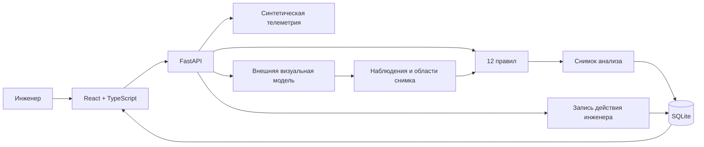

# Архитектура КОНТУР

## Поток осмотра

React показывает паспорт агрегата, графики, карту узлов, предупреждения и историю. FastAPI получает выбранный демосценарий, объединяет визуальные наблюдения и выполняет правила. SQLite хранит результаты и действия. Модель получает снимок через серверный адаптер, ключ не передаётся браузеру.

Vite обслуживает интерфейс в разработке и проксирует `/api` на порт 8000. После `npm run build` FastAPI может отдавать `apps/web/dist` с того же адреса, что и API.

## Границы модулей

| Путь | Назначение |
|---|---|
| `apps/web/src/App.tsx` | Рабочая область, сценарии, карточки узлов и регистрация результатов |
| `apps/web/src/features/CameraPanel.tsx` | Снимок, загрузка изображения, QR и встроенный AR |
| `apps/web/src/features/StandPanel.tsx` | QR-код и печатный стенд |
| `apps/web/public/ar.html` | Маркерный AR на A-Frame и AR.js |
| `services/api/app/main.py` | HTTP-контракты, объединение входов, фиксация результата |
| `services/api/app/diagnostics/engine.py` | Вычисление признаков, 12 правил, пропуски и объединение гипотез |
| `services/api/app/demo.py` | Детерминированные сценарии телеметрии и наблюдений |
| `services/api/app/equipment.py` | Единственный демонстрационный паспорт Н-101 |
| `services/api/app/vision.py` | Вызов модели и строгая проверка её ответа |
| `services/api/app/storage.py` | Добавление снимков анализа и событий в SQLite |

## HTTP-контракт

| Метод и путь | Результат |
|---|---|
| `GET /api/health` | Доступность процесса API |
| `GET /api/bootstrap` | Паспорт, перечень сценариев, конфигурация визуального адаптера |
| `GET /api/equipment` | Паспорт с информацией о записях и заменах |
| `POST /api/analyze` | Сохранённый снимок анализа выбранного сценария и наблюдений |
| `POST /api/vision` | Сохранённый структурированный результат анализа снимка |
| `GET /api/inspections` | Все события вместе с исходным анализом |
| `POST /api/inspections` | Новая проверка, замечание, обслуживание или замена |
| `GET /api/images/{image_id}` | Сохранённый снимок осмотра с соответствующим MIME-типом |

Точные схемы запросов доступны в `/docs`. `AnalyzeRequest` принимает `scenario_id`, необязательные `vision_id` и `image`, а также ручные наблюдения `{kind, present, timestamp?}`. `image` — data URL допустимого изображения. Он позволяет сохранить снимок и при ручном осмотре без ответа модели. При подключении результата модели демонстрационные наблюдения её трёх классов заменяются результатом модели. Ручное наблюдение заменяет прежнее наблюдение того же класса. Источник сохраняется как `demo`, `model` или `manual`.

Запись работы ссылается на уже существующий анализ через `analysis_id`. Она включает `component_id`, `action`, `notes`, `author`. Неизвестный узел, неизвестный анализ или попытка зарегистрировать работу непосредственно по записи визуального ответа отклоняются.

## Объяснимые результаты

Правило возвращает одно из состояний: `triggered` (условия выполнены), `clear` (условия не выполнены), `insufficient` (выводу не хватает данных). Неполные, устаревшие или несогласованные входы не подменяются нормальными значениями. Одна точка не доказывает тренд.

Предупреждение содержит гипотезу, узел, приоритет, идентификаторы правил, измерения, использованные пороги, источники и следующий шаг проверки. Совпадающие гипотезы кавитации R02/R12 объединяются с сохранением оснований. Визуальное отсутствие кожуха проверяется отдельно от состояния датчиков.

КПД, перекос фаз и расхождение давления имеют явные формулы. Падение КПД на 15% означает относительное изменение, а не 15 процентных пунктов. Показания давления сравниваются по времени, единицам и заданному знаменателю. Упоминание интервалов обслуживания или ресурса относится только к демонстрационным параметрам.

## Модель и недоступность сервиса

`VisionClient` обращается к `https://agentrouter.org/v1/chat/completions`, модель задаётся `VISION_MODEL` (по умолчанию `gpt-6-astra`). Секрет читается из `VISION_API_KEY` либо `AGENTROUTER_API_KEY`. Тайм-аут запроса — 75 секунд.

Ответ ограничен тремя классами: отсутствие кожуха, видимая жидкость у уплотнения, отсутствующий крепёж. Качество `good` передаётся в правила вместе с наблюдениями. `limited` не считается достаточным модельным основанием для срабатывания, а `unreadable` даёт пустой список наблюдений. Адаптер не создаёт числовой `confidence`. `bbox` задаётся четырьмя нормированными координатами `[x1,y1,x2,y2]` в диапазоне 0–1. Неизвестные поля, некорректные координаты и нарушенная структура отклоняются.

Ошибка сети, тайм-аут, HTTP-ошибка или некорректный ответ возвращаются пользователю явно. Демонстрационный режим не подменяет неудачный ответ внешнего сервиса. Проверка `GET /v1/models` вернула HTTP 401 и `error.message`, начинающееся с `unauthorized client detected, contact support for assistance`. Это ограничение API-клиента шлюзом. Новый ключ успешно прочитан из пользовательского окружения Windows без пробельных символов, поэтому невалидность ключа не доказана. Необходим разрешённый API-доступ для этого клиента; повторная смена ключа не подтверждена как решение. Живое распознавание ещё не валидировано.

Снимок отправляется провайдеру только при запуске анализа пользователем. В локальном результате сохраняются наблюдения, модель, источник, время и `image_id`. Переданное на сервер изображение хранится в таблице `images` как data URL. SHA-256 от data URL служит идентификатором, `INSERT OR IGNORE` исключает повторное хранение одинаковых данных. Браузер может уменьшать и перекодировать загруженный файл до отправки, поэтому база хранит именно снимок осмотра, полученный сервером.

## История и обслуживание

Таблица `analyses` хранит JSON-снимок результата и ссылку `image_id`, если изображение приложено. Таблица `events` ссылается на анализ внешним ключом. Таблица `images` хранит изображения отдельно. История показывает снимок через `/api/images/{image_id}`. В интерфейсе и API нет редактирования/удаления событий. Последующее переключение демосценария не переписывает основания ранее сохранённой работы.

Обслуживание всего агрегата учитывается при следующем расчёте интервала обслуживания. Для заменённого компонента карточка считает наработку от значения, сохранённого в анализе на момент замены, и пересчитывает нормативный остаток. Другие узлы сохраняют свои опорные значения. Неизвестная текущая или опорная наработка не заменяется нулём и даёт неизвестный результат. Это нормативный расчёт, а не оценка времени до отказа. Регламентный срок, время до ТО и признаки фактического состояния остаются разными понятиями.

Хранилище локальное, без разграничения ролей, криптографической защиты журнала и резервного копирования как сервиса. Автор записи по умолчанию — «Демо-инженер». Эти свойства подходят для демонстрации, но требуют доработки перед многопользовательской эксплуатацией.

## QR и AR

QR с содержимым `kontur:<equipment_id>` идентифицирует карточку объекта каталога; идентификатор проверяется по `GET /api/catalog`, незнакомый код карточку не открывает. Маркер Hiro задаёт положение печатного стенда. Координаты AR-узлов заранее заданы относительно схемы, поэтому масштаб и взаимное расположение схемы/маркера на стенде нужно сохранять.

Локальные зависимости находятся в `public/vendor`. Для всех 10 компонентов карточки заданы AR-метки. При потере маркера объекты скрываются. Нажатие метки показывает название узла, подробные основания доступны в карточке рабочего интерфейса. AR не определяет геометрию произвольного оборудования. Области модели привязаны только к неподвижному снимку и не отслеживаются в видеопотоке.

Обнаружение Hiro и скрытие меток после его потери проверены в браузере на поданном видеопотоке печатного стенда: `markerDetected=true`, `markerHiddenAfterLoss=true`, `errors=[]`. Этот прогон не использует физический телефон.

Для камеры необходим HTTPS либо localhost на том же устройстве. Доверенный адрес для реального телефона и испытания на нём остаются отдельным этапом. Проверка видеопотока и мобильной вёрстки не заменяет проверку физической камеры в условиях площадки.
